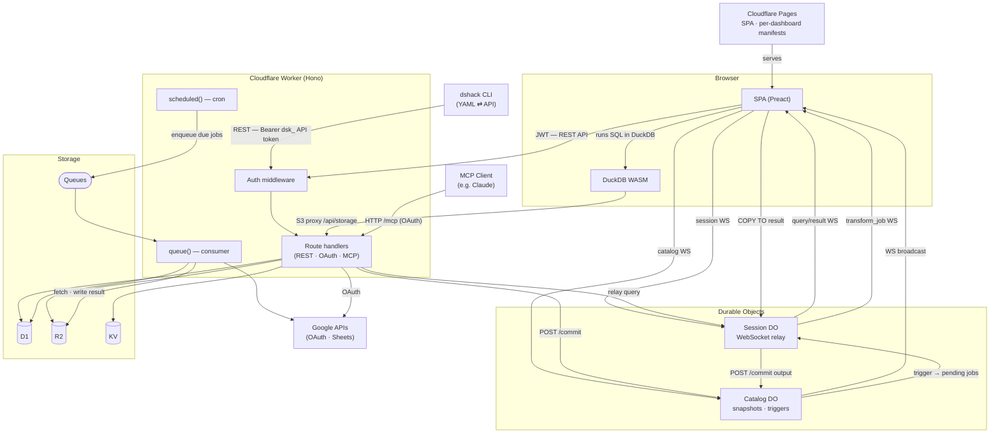

# Architecture

## Overview

data-shack is a personal data warehouse on Cloudflare in which **the browser is the compute engine**. The Worker authenticates, stores metadata and proxies storage; SQL runs in a DuckDB-WASM instance in the user's tab. Each user is their own tenant: their own catalog Durable Object, credentials, backends and storage namespace.

There are three ways in, all ending at the same Worker API:

| Client | Auth | Purpose |
|---|---|---|
| **Browser SPA** | Google OAuth → JWT (1 h) + rotating refresh token (30 d) | Querying, workbench IDE, dashboards; hosts the DuckDB engine |
| **MCP client** (Claude is the reference example) | The same OAuth flow, via dynamic client registration and PKCE | AI-driven exploration, dashboard authoring, pipeline management |
| **`dshack` CLI** | OAuth login, or a long-lived `dsk_` API token | Infrastructure-as-code for warehouse resources |

## Components

### Worker (`src/index.ts`)

A Hono app exporting `{ fetch, scheduled, queue }`. `requireAuth` accepts, in order: an `X-Dev-Token` header (local dev only), a `dsk_` API token (hashed lookup in D1, independent of OAuth), or a Bearer JWT whose audience must be `<issuer>/mcp`. Route groups: the OAuth router, REST endpoints, the storage proxy sub-router (`/api/storage`), the MCP server (`/mcp`), and the catalog/session WebSocket upgrades.

- `scheduled()` runs every minute, finds due load jobs in D1 and enqueues `{ jobId }` to Queues.
- `queue()` consumes those messages and runs the loader (retries up to 3 times).

All SQL against D1 lives in `src/db/*`; no inline SQL elsewhere.

### Storage layer

| Store | Holds |
|---|---|
| **D1** | Users, OAuth identities/clients/codes/refresh tokens, `allowed_emails`, encrypted credentials and storage backends, load jobs, dashboards and their version snapshots, saved queries, API tokens |
| **Catalog DO (SQLite)** | Warehouse metadata: tables, snapshots, commits, transform jobs, triggers |
| **R2 / S3-compatible** | The data files themselves (NDJSON, Parquet) |
| **KV** | Short-lived S3 proxy credentials |
| **Queues** | Load job dispatch |

D1 is deliberately a vault and registry (credentials, backend config, definitions of things users author). Warehouse metadata belongs to the catalog DO.

### Catalog Durable Object

One instance per user; the source of truth for what the warehouse contains. Tables → snapshots (each a storage URI, backend, format and timestamp) plus a commit log. Writes are serialised inside the DO, so concurrent loaders cannot race.

- **Commit broadcast.** After each `POST /commit`, the DO sends `{ type: "commit", table, snapshotId, uri, … }` to every connected tab using the WebSocket hibernation API. Tabs refresh the affected view and any open dashboards.
- **Batch reads.** `snapshots-latest` returns every table with its latest snapshot in one LEFT JOIN, and `snapshots-all` returns the full history; the browser uses them to build views and the `catalog_snapshots` table.
- **Transform jobs and triggers** live here too. A job moves `idle → pending → running → done/failed`. A trigger watches a JSON array of tables with policy `any` (fire on any new snapshot) or `all` (fire only when every watched table has a snapshot newer than the job's `last_completed_at`). Qualifying jobs go to `pending` and their IDs come back from the commit as `triggeredJobIds`. Because a transform's output is itself a commit, chains of transforms work with no DAG scheduler.

### Session Durable Object

Ephemeral relay between server-side callers and a live browser tab. The browser holds a WebSocket to it. When the MCP server needs SQL executed, it posts to the session DO, which forwards the query to the tab, streams rows back and resolves the request; with no tab open the caller gets an explicit "no session" error rather than a hang. On connect it dispatches pending transform jobs to the tab; on disconnect it resets `running` jobs to `pending`. It also receives `job_complete`, commits the output to the catalog DO and marks the job done.

### Browser

A Preact SPA on Cloudflare Pages, with a Pages Function layer that serves per-dashboard titles and web manifests so a dashboard can be installed as its own home-screen shortcut.

- **DuckDB-WASM** executes all SQL. `registerCatalogViews` creates a view per catalog table, and `catalog_snapshots` exposes version history to SQL.
- **Catalog WebSocket** keeps views current; **session WebSocket** lets the tab serve MCP queries and run transform jobs (it waits for catalog freshness before running one).
- A **session toggle** can turn DuckDB off (default on mobile). Dashboards then fall back to `GET /api/table-data/:table`, which streams a single table's raw JSON/NDJSON through the Worker.
- The **workbench** (`/workbench`) is the main UI: explorer, SQL/transform/dashboard editors, console and command palette.
- Dashboards render in a `sandbox="allow-scripts"` iframe (no `allow-same-origin`) with pinned React, Babel and Recharts.

### Storage proxy

DuckDB's `httpfs` talks to the Worker as if it were S3. The browser requests a short-lived credential (`POST /api/storage/proxy-credentials`, stored in KV) and installs it with `CREATE OR REPLACE SECRET`. Requests to `/api/storage/s3proxy/:bucket/*key` are authenticated by that credential's access key and then dispatched by backend type:

| Backend type | Mechanism |
|---|---|
| `r2-bound` | R2 Worker binding, scoped to the user's key prefix |
| `r2-s3compat` | Re-signed SigV4 request to the upstream S3-compatible service |
| `google-sheets` | Sheets API v4: GET returns rows as JSON, PUT writes values; the key names the tab |

GET, HEAD, PUT, ListObjectsV2 and OPTIONS are supported, so DuckDB can read Hive-partitioned datasets and write partitioned output. The real backend credentials never leave the Worker.

### URI resolution

The catalog stores URIs, not R2 keys. `r2://backendName/key` is the universal scheme (name looked up first, then ID; the legacy `r2-s3compat://id/key` still resolves). `http-ds://credentialId/path` resolves to a short-lived proxy URL through which the Worker injects the credential's headers. `catalog://table` resolves to that table's latest snapshot. Adding a new backend means adding a resolver case in the proxy and a `storage_backends` row; the catalog and browser are unchanged.

## Data flows

### Ingest (load jobs)

1. `scheduled()` enqueues due jobs → `queue()` fetches the job.
2. By `source_type`: `http` (HTTP fetch, optional cursor pagination with multipart streaming, date-range parameterisation) or `google-sheets` (token refresh → Sheets API → NDJSON, 50 MB buffer limit).
3. The loader writes to the configured backend, commits the new snapshot to the catalog DO, and updates `last_run_at`/`last_error`/`next_run_at` in D1.
4. The commit broadcasts to open tabs and evaluates triggers.

Load jobs run entirely server-side, so they are always runnable.

### Transform (browser-executed)

1. A commit fires a trigger → job `pending` → session DO sends `transform_job` to a connected tab (or on next connect).
2. The tab awaits catalog readiness, replies `job_claimed`, acquires proxy credentials for the output backend, runs the multi-statement SQL (a `COPY … TO`) in DuckDB, and replies `job_complete` or `job_error`.
3. The session DO commits the output URI to the catalog and marks the job done, which may fire downstream triggers. Closing the tab mid-job returns the job to `pending`. Jobs are idempotent: inputs and output URIs are deterministic.

Because transform SQL can read `catalog_snapshots`, a transform can accumulate history incrementally (merge only snapshots newer than a watermark into its own previous output).

### Dashboards

A dashboard is `{ title, slug, artifact source (≤ 50 KB), queries[] }` in D1; `data[i]` is the result of `queries[i]`. Every update or delete writes a row to `dashboard_snapshots`, so history is retained. The viewer runs the queries (DuckDB or proxy mode), injects the results into the sandboxed iframe, and re-runs on catalog commits.

## MCP server

Mounted at `/mcp` on the main Worker (`src/mcp/server.ts`), speaking Streamable HTTP (MCP 2025-03-26) behind the standard OAuth flow. Any MCP client can connect; **Claude** is the reference client — add `https://<worker>/mcp` as a custom connector, sign in, and the tools below appear in a conversation. Tools split by whether they need a live browser tab:

| Group | Tools | Needs browser tab |
|---|---|---|
| Discovery | `get_warehouse_schema`, `list_data_sources` | No |
| Query | `run_query` | **Yes** — relayed through the session DO |
| Read | `read_data` (`r2://`, `http-ds://`, `catalog://`; 1 MB cap) | No |
| Dashboards | `submit_dashboard`, `list_dashboards`, `get_dashboard`, `update_dashboard` | No |
| Load jobs | `list/create/update/delete_load_job`, `set_load_job_enabled`, `trigger_load_job` | No |
| Transform jobs & triggers | `list/create/update/delete/trigger_transform_job`, `list/create/delete_trigger` | Only to *run* a job |

Job tools resolve credentials and backends by name or ID, and `update_*` tools are true partial patches. They use the same validation as the REST routes. The intended loop with Claude: explore the schema, prototype SQL via `run_query`, refine a visual, `submit_dashboard`, and then wire up load jobs and triggers so it stays fresh. Direct-access tables (JSON/NDJSON in storage) can be read without a browser at all.

## `dshack` CLI

`cli/` is a Node CLI that treats the warehouse as infrastructure-as-code. A workspace is a git repository of YAML files (`data-sources/`, `transforms/`, `catalog/`, `dashboards/`), with long SQL and JSX in sidecar files, and a committed `.dshack/state.json` mapping each file to its live resource ID and content hash.

- `plan` diffs files against state without needing secrets; `apply` creates, updates and deletes through the REST API in dependency order (credentials → backends → jobs/transforms/queries/dashboards), saving state after each resource so a failure is resumable; `destroy` removes one resource; `init --pull` imports an existing deployment into YAML.
- Secrets are `$ENV:NAME` or `$DOPPLER:NAME` references resolved only when a resource is written; they never reach disk. Resources hash as written, so plans need no secrets.
- Transforms carry their triggers inline and are applied as one resource.
- **Auth:** interactive PKCE login, or a long-lived API token for CI (`dshack auth create-token`). API tokens are `dsk_`-prefixed, shown once, stored server-side only as a SHA-256 hash, can expire, are revocable (`GET/POST/DELETE /api/tokens`), and cannot mint further tokens. `DS_TOKEN` / `DS_WORKER_URL` environment variables override stored credentials, which suits CI and cloud agent sessions.

The CLI only calls the public REST API, so it needs no special worker support beyond API tokens.

## Security model

- **Credentials** are AES-GCM encrypted in D1 and decrypted only in the Worker at request time; the browser sees only short-lived proxy credentials.
- **Tenant isolation:** per-user catalog DO; `r2-bound` keys are prefixed with the user's namespace and out-of-namespace requests are rejected; D1 queries are scoped by `user_id`.
- **Signup** is gated by `allowed_emails`; existing identities are always admitted. Tokens are audience-checked, and refresh tokens are stored hashed and rotated on every use.
- **Dashboards** run untrusted JavaScript in a cross-origin sandboxed iframe.
- **Web auth on mobile:** the PKCE verifier and state live in short-lived `__Host-` cookies so the OAuth round trip survives the PWA → Custom Tab switch on Android.

## Design principles

- **Browser is the compute boundary.** Queries, transforms and compaction run in DuckDB-WASM; raw data never passes through a central compute server.
- **Two DO classes with distinct jobs.** The catalog DO is persistent warehouse state; the session DO is ephemeral routing.
- **D1 for credentials and definitions, the catalog DO for warehouse metadata.**
- **Load jobs are always runnable; transform jobs are conditionally runnable** (they queue until a browser claims them).
- **Trigger-on-commit, not a DAG scheduler.** Chains emerge from commits triggering transforms.
- **AI-first authoring.** The MCP server is a first-class client: whatever the UI can define, an assistant can define.
- **Everything is declarable.** The same resources the UI edits can be kept as YAML and synced with `dshack`.
- **Storage is backend-agnostic.** Catalog entries are URIs; the proxy resolves them; DuckDB never knows which backend it is reading.
- **Control plane through the Worker, data plane through the proxy.** Auth, metadata and credentials are handled by the Worker, and all storage traffic is authenticated and re-signed there, so no bucket CORS or exposed keys are needed.
- **Cloudflare-native by default, not by constraint.** The data layer is replaceable.
